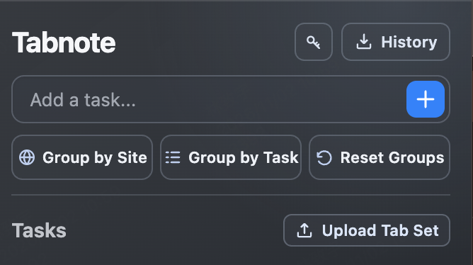

<p align="center">
  
</p>

<h1 align="center">Tabnote</h1>

<p align="center"><strong>Give your tabs a place to belong.</strong><br>Group open Chrome tabs by website or task, keep your own edits, and share a task's pages as a tab set.</p>

<p align="center">
  <a href="manifest.json"></a>
  <a href="manifest.json"></a>
  <a href="manifest.json"></a>
</p>

<p align="center">
  <a href="#get-started">Get started</a> ·
  <a href="#what-you-can-do">What you can do</a> ·
  <a href="#share-a-tab-set">Share a tab set</a> ·
  <a href="#privacy">Privacy</a>
</p>

<p align="center">
  
</p>

<p align="center"><em>A compact popup for turning scattered tabs into Chrome tab groups.</em></p>

## A simple workflow

**Name a task → Group by Task → move any tab by hand → export the task's tab set.**

Tabnote groups pages in Chrome's native tab strip. It remembers manual moves and previous task decisions, so sorting again focuses on tabs that still need a decision. Existing groups stay in place unless you choose **Reset Groups**.

## Get started

Tabnote currently runs as a local Chrome extension. No account or build step is required.

1. Download or clone this repository.
2. Open `chrome://extensions` in Chrome 102 or newer and enable **Developer mode**.
3. Click **Load unpacked** and select this folder, the one containing `manifest.json`.
4. Pin Tabnote to the toolbar and open the popup.
5. Click **Group by Site** for immediate local grouping. For task grouping, add a task, set your TypeSafe API key with the key icon, and click **Group by Task**.

> [!IMPORTANT]
> A TypeSafe API key is needed only for task decisions that are not already saved. Site grouping, activity history, and tab-set import/export work without one.

## What you can do

| In the popup | Result |
| --- | --- |
| **Add a task...** | Create a named task. Each task also has buttons to sort only for that task, export its tabs, rename it, or remove it. |
| **Group by Site** | Put unpinned, ungrouped HTTP(S) tabs from the same hostname into native groups. A site needs at least two tabs to form a new group. |
| **Group by Task** | Compare ungrouped tab titles with your tasks using TypeSafe System One, then group confident matches. |
| **Reset Groups** | Remove groups created by Tabnote and pause sorting, while keeping the tabs open. |
| **History** | Download a TXT activity log of tabs added and closed, with timestamps and tab details. |
| **Upload Tab Set** | Open a shared Tabnote TXT file as tabs and a task group in the current Chrome window. |

After you select a grouping mode, Tabnote also sorts eligible new or updated tabs. It leaves tabs in existing groups alone. Task decisions are saved by title and task; a repeat decision uses the saved result instead of calling the API again. The match threshold is 0.50, with a 0.05 lead over the next task. Uncertain pages stay ungrouped. Moving a tab into a task group by hand records your preference for future sorting.

## Share a tab set

Click the **download icon beside a task** to export the web tabs currently open in that task group, across Chrome windows. The TXT contains the task name and each tab's title and URL:

```text
Tabnote Task Group v1
Task: "Review paper"
Tabs:
{"title":"Conference guidelines","url":"https://example.org/guidelines"}
{"title":"Related work","url":"https://example.org/paper"}
```

Send that file to someone using Tabnote. They can click **Upload Tab Set** to open its pages and create or reuse the named task group. The file is read locally; importing does not require an API key. Upload accepts up to 500 HTTP(S) pages.

> [!NOTE]
> Check a TXT before sharing it: titles and full URLs may contain private information. The TXT from **History** is a different format and cannot be uploaded as a tab set.

## Privacy

| Data | Storage or destination |
| --- | --- |
| Tasks, sorting mode, and settings | Chrome local storage on your device |
| Saved task decisions, manual placements, and tab activity | IndexedDB on your device |
| TypeSafe API key | Chrome session storage; cleared at the end of the browser session |
| New task classification decisions | Page **title** and task **names** sent to TypeSafe System One |
| Exported TXT | Downloaded to your device |

Tabnote does not send page URLs or page content to TypeSafe. Site grouping and activity logging run locally. Logging begins when the extension is installed; exporting the history does not clear it.

## Troubleshooting

For task sorting details, open `chrome://extensions`, find Tabnote, and inspect its **Service worker**. Messages beginning with `[Tabnote]` show API requests, saved decisions, scores, and errors. Pinned tabs, tabs already in groups, internal browser pages, and pages still loading are not classified.

After editing extension files locally, click **Reload** on Tabnote's card in `chrome://extensions`.

## Project status

Tabnote is a local prototype and has not been publicly licensed yet. A license is needed before presenting the source as an open-source release.
